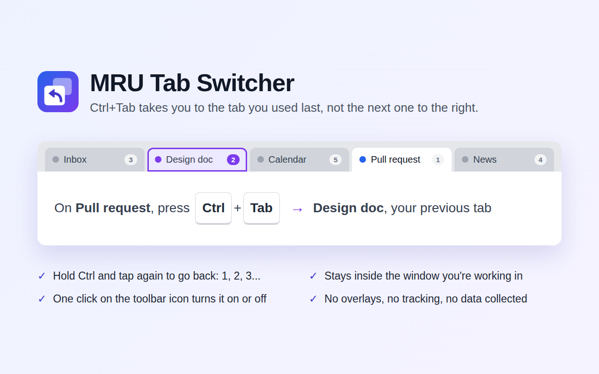

# MRU Tab Switcher


**Ctrl+Tab takes you to the tab you used last, not the next one to the right**, the way Brave does. Hold Ctrl and keep tapping Tab to go further back through your recent tabs; let go of Ctrl to stay there.

It works in the background with nothing on screen: no overlays, no popups, and no data collected.

- **One tap** goes to the tab you were on before this one.
- **Hold Ctrl and tap Tab again** to go further back: 2nd most recent, 3rd, and so on, wrapping round to where you started. Take as long as you like; the cycle ends when you let go of Ctrl, or click the mouse, just like Brave.
- **Ctrl+Shift+Tab goes the other way** through the same list, so on its own it jumps to the tab you've used least recently. You can mix both directions in one go.
- **Works like Brave:** every tab you land on, even briefly while cycling, counts as recently used.
- **Stays in your window.** Switching only cycles through the tabs of the window you're working in.
- **Where extensions can't run** (the New Tab page, `chrome://` pages, the Chrome Web Store), Chrome doesn't let the extension see you let go of Ctrl, so there a pause of 0.7 seconds between taps ends the cycle instead.
- **On/off with one click.** Click the toolbar icon to toggle it; the badge shows **ON** (green) or **OFF** (gray). While it's off, Ctrl+Tab and Ctrl+Shift+Tab behave like Chrome's normal "next tab" and "previous tab".



## Install

### From the Chrome Web Store

Coming soon.

### From source

1. Download this repository: [main.zip](https://github.com/Hariprasad-b-s/mru-extension/archive/refs/heads/main.zip), then unzip it. Or `git clone https://github.com/Hariprasad-b-s/mru-extension.git`.
2. Keep the folder somewhere permanent. Chrome loads the extension from it every time.
3. Open `chrome://extensions` and turn on **Developer mode** (top right).
4. Click **Load unpacked** and pick the folder that contains `manifest.json`.
5. Pin it from the puzzle-piece menu so you can see its ON/OFF badge.

Chrome will say the extension can "read and change all your data on all websites". That's the broad wording Chrome uses for any extension with a script in web pages; this one's script only notices when you let go of Ctrl during a tab switch (see [Privacy](#privacy)).

It works straight away with **Alt+Y** and **Alt+Shift+Y** (in reverse), or **Control+Y** and **Control+Shift+Y** on macOS. To use Ctrl+Tab and Ctrl+Shift+Tab instead, do the one-time setup below.

## Use Ctrl+Tab (one-time setup)

Chrome won't let an extension set Tab shortcuts itself, and the Keyboard shortcuts page won't let you type Tab. The page's own developer API does accept it, so you set it from the DevTools console, the same way [QuicKey](https://fwextensions.github.io/QuicKey/ctrl-tab/) does.

1. Open `chrome://extensions/shortcuts`.
2. Open DevTools: **Ctrl+Shift+J** on Windows/Linux, **Cmd+Option+J** on macOS.
3. Paste the code below into the Console and press **Enter**. If Chrome asks, type `allow pasting` first, then paste again.

```js
(() => {
  const SHORTCUTS = {
    'switch-to-previous-tab': 'Ctrl+Tab',
    'cycle-in-reverse': 'Ctrl+Shift+Tab',
  };

  const api = chrome.developerPrivate;
  if (!api) {
    console.error('Run this on chrome://extensions/shortcuts, not on a regular page.');
    return;
  }

  // Find the extension by its command rather than its ID: a Chrome Web Store
  // install and an unpacked copy have different IDs. Only enabled ones count.
  api.getExtensionsInfo({}, (all) => {
    const matches = all.filter(
      (ext) => /MRU/i.test(ext.name) && ext.commands.some((c) => c.name === 'switch-to-previous-tab'),
    );
    if (matches.length === 0) {
      console.error('MRU Tab Switcher is not installed, or is turned off.');
      return;
    }
    if (matches.length > 1) {
      console.warn(
        `${matches.length} copies are installed; setting the first. Remove the ` +
          'extras on chrome://extensions, then run this again.',
      );
    }

    const { id, commands } = matches[0];
    // An older version may not have every command yet.
    const toSet = Object.entries(SHORTCUTS).filter(([name]) => commands.some((c) => c.name === name));
    for (const [name] of Object.entries(SHORTCUTS)) {
      if (!toSet.some(([n]) => n === name)) {
        console.warn(`This version has no "${name}" command; update the extension, then run this again.`);
      }
    }

    // Set them one after another, then read back what Chrome actually stored:
    // it clears the old shortcut first and reports no error if a new one is
    // rejected.
    const setNext = (i) => {
      if (i < toSet.length) {
        const [commandName, keybinding] = toSet[i];
        api.updateExtensionCommand({ extensionId: id, commandName, keybinding }, () => setNext(i + 1));
        return;
      }
      api.getExtensionInfo(id, (info) => {
        for (const [commandName, wanted] of toSet) {
          const { keybinding } = info.commands.find((c) => c.name === commandName);
          if (keybinding) {
            console.log(`${info.name}: ${commandName} is now ${keybinding}.`);
          } else {
            console.error(`Chrome rejected "${wanted}" for ${commandName}; that shortcut is now unset.`);
          }
        }
      });
    };
    setNext(0);
  });
})();
```

4. It should print `...: switch-to-previous-tab is now Ctrl+Tab.` and `...: cycle-in-reverse is now Ctrl+Shift+Tab.`, and the shortcuts page should show **Ctrl + Tab** and **Ctrl + Shift + Tab** (⌃⇥ and ⌃⇧⇥ on macOS).

The same code is in [`scripts/set-ctrl-tab-shortcut.js`](scripts/set-ctrl-tab-shortcut.js). It works for a Web Store install and a source install alike, and it's safe to run more than once. On macOS, "Ctrl" means the Control key here, so the code is the same on every platform.

To go back to normal shortcuts, set them on the shortcuts page as usual. While they're bound to this extension, Chrome's own Ctrl+Tab and Ctrl+Shift+Tab ("next/previous tab") are replaced; use **Ctrl+PgDn / Ctrl+PgUp** (Windows/Linux) or **Cmd+Option+→ / ←** (macOS) for those instead, or switch the extension OFF.

## Updating a source install

Download the new files into the same folder (or `git pull`), then click the reload arrow on the extension's card in `chrome://extensions`. Your shortcut stays set.

If you installed a copy before the extension had a fixed ID, remove it and use **Load unpacked** again once. The Ctrl+Tab script tells you if more than one copy is installed.

## Privacy

The extension keeps the order you used your tabs in, as tab ID numbers in the browser's memory, and remembers whether it's switched on.

To end a cycle when you let go of Ctrl, as Brave does, a small listener ([`content.js`](content.js)) runs in each web page. It stays idle until you're switching tabs, then only watches for modifier keys being released or pressed and for mouse clicks, and tells the extension "stop cycling". It never reads or changes page content, and nothing it sees is stored or sent anywhere. The extension makes no network requests and collects nothing. See [PRIVACY.md](PRIVACY.md).

## Publishing

`./scripts/package.sh` builds the zip to upload to the Chrome Web Store. The listing text, images and step-by-step instructions are in [store/listing.md](store/listing.md).

## Files

| Path | What it is |
| --- | --- |
| `manifest.json` | Extension manifest (Manifest V3) |
| `background.js` | Service worker: tab tracking, switching and the ON/OFF toggle |
| `content.js` | Listener in each page that reports when Ctrl is let go during a tab switch |
| `icons/` | Extension icons, plus `icon.svg`, the source they're rendered from |
| `scripts/set-ctrl-tab-shortcut.js` | Ctrl+Tab setup code to paste into DevTools |
| `scripts/package.sh` | Builds `dist/mru-tab-switcher-<version>.zip` for the Web Store |
| `store/` | Web Store listing text and images |
